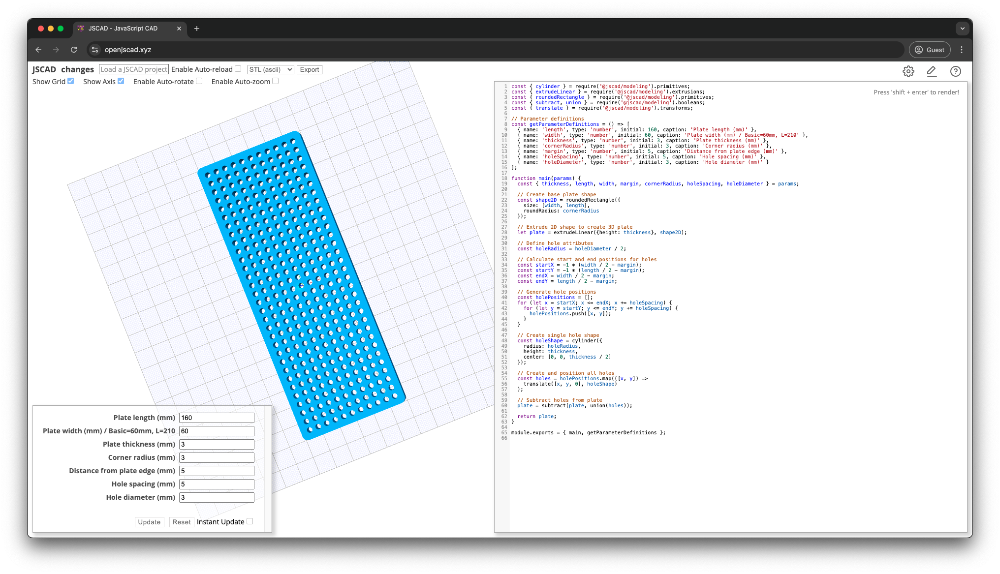

# TAMIYA UNIVERSAL PLATE GENERATOR

**Generate printable, parametric plates modeled on the TAMIYA Universal Plate, right in your browser.**

[Highlights](#highlights) · [Quick start](#quick-start) · [Parameters](#parameters) · [Ready-made STL files](#ready-made-stl-files) · [Disclaimer](#disclaimer)

A single [JSCAD](https://openjscad.xyz) script that builds a rounded plate with a regular grid of through holes, made as a dimensional reference for compatible plates for the [TAMIYA UNIVERSAL PLATE](https://www.tamiya.com/japan/products/70098/index.html). Change the numbers in the form, render, and export an STL for your 3D printer.

## Highlights

- **Any size.** Set length, width and thickness yourself. The defaults make a 60 × 160 mm plate, 3 mm thick.
- **Basic and L widths.** The width field notes the two standard widths: 60 mm (Basic) and 210 mm (L).
- **Holes follow the plate.** The default 3 mm holes on a 5 mm pitch give 341 holes on the 60 × 160 mm plate and 1271 on the 210 × 160 mm one.
- **Everything is adjustable.** Corner radius, edge margin, hole spacing and hole diameter are all form fields.
- **Nothing to install.** It runs in the JSCAD web app, and the script is one short file.

## Quick start

1. Open [openjscad.xyz](https://openjscad.xyz).
2. Paste the contents of [`tamiya_universal_plate_generator.js`](tamiya_universal_plate_generator.js) into the editor, or load the file with **Load a JSCAD project**.
3. Press `Shift` + `Enter` to render, then change the values in the parameter form and click **Update**.
4. Choose **STL (ascii)** in the format list and click **Export**.

## Parameters

| Parameter | Default | Meaning |
|---|---|---|
| Plate length | 160 mm | Length of the plate |
| Plate width | 60 mm | Width of the plate (Basic = 60 mm, L = 210 mm) |
| Plate thickness | 3 mm | Thickness of the plate |
| Corner radius | 3 mm | Radius of the rounded corners |
| Distance from plate edge | 5 mm | Margin between the plate edge and the outermost holes |
| Hole spacing | 5 mm | Distance between hole centers |
| Hole diameter | 3 mm | Diameter of each hole |

## Ready-made STL files

Two plates exported with the defaults are included, in case you only want to print.

| File | Size (width × length × thickness) |
|---|---|
| [`tamiya_universal_plate_160x60.stl`](stls/tamiya_universal_plate_160x60.stl) | 60 × 160 × 3 mm |
| [`tamiya_universal_plate_160x210.stl`](stls/tamiya_universal_plate_160x210.stl) | 210 × 160 × 3 mm |

## Contributing

Contributions are welcome! Please feel free to submit a Pull Request. To report a security problem, see [SECURITY.md](SECURITY.md).

## Disclaimer

This is an unofficial tool made by an individual and is not affiliated with TAMIYA, INC. TAMIYA is a registered trademark of TAMIYA, INC. It is published as a dimensional reference for making compatible plates.

## License

This project is licensed under the [MIT License](LICENSE).
